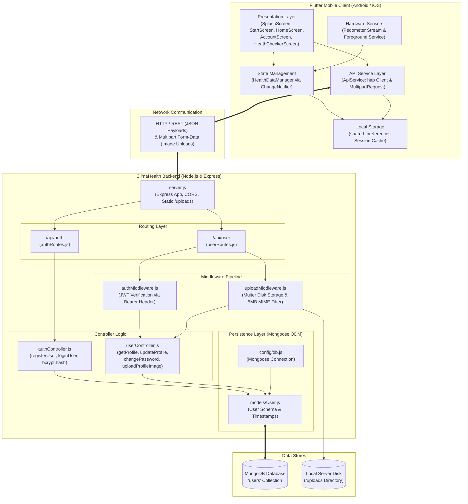

# 🌿 ClimaHealth

<p align="center">
  
</p>

<p align="center">
  <strong>A full-stack healthcare companion and real-time physical activity tracking platform.</strong>
</p>

<p align="center">
  <a href="https://flutter.dev"></a>
  <a href="https://dart.dev"></a>
  <a href="https://nodejs.org"></a>
  <a href="https://expressjs.com"></a>
  <a href="https://www.mongodb.com"></a>
  <a href="https://jwt.io"></a>
  
</p>

<p align="center">
  <strong>GitHub Repository:</strong> <a href="https://github.com/abhishekmghayal/ClimaHealthMainFlutterRepo">https://github.com/abhishekmghayal/ClimaHealthMainFlutterRepo</a>
</p>

---

## 📑 Table of Contents

- [Project Overview](#-project-overview)
- [System Architecture](#-system-architecture)
- [Feature Implementation Status](#-feature-implementation-status)
  - [1. User Authentication & Session Security](#1-user-authentication--session-security)
  - [2. User Profile Management](#2-user-profile-management)
  - [3. Health Activity & Cadence Tracking](#3-health-activity--cadence-tracking)
  - [4. Healthcare Discovery & Pharmacy (Sample Data)](#4-healthcare-discovery--pharmacy-sample-data)
  - [5. Clima Assistant & Service Stubs (Presentation UI)](#5-clima-assistant--service-stubs-presentation-ui)
- [Visual Assets & Screen Gallery](#-visual-assets--screen-gallery)
- [Technology Stack](#-technology-stack)
- [Project Directory Structure](#-project-directory-structure)
- [Prerequisites](#-prerequisites)
- [Installation & Setup](#-installation--setup)
  - [1. Clone the Repository](#1-clone-the-repository)
  - [2. Backend Setup](#2-backend-setup)
  - [3. Frontend Setup](#3-frontend-setup)
  - [4. Building Release Artifacts](#4-building-release-artifacts)
- [Network Configuration & Environment Variables](#-network-configuration--environment-variables)
  - [Configuring the API URL](#configuring-the-api-url)
  - [Environment Variables (.env.example)](#environment-variables-envexample)
- [REST API Documentation](#-rest-api-documentation)
- [Testing & Quality Assurance](#-testing--quality-assurance)
- [Security & Privacy Practices](#-security--privacy-practices)
- [Medical & AI Disclaimer](#-medical--ai-disclaimer)
- [Troubleshooting Guide](#-troubleshooting-guide)
- [Project Roadmap](#-project-roadmap)
- [Contributing](#-contributing)
- [License & Author](#-license--author)

---

## 📖 Project Overview

**ClimaHealth** is a modern, full-stack mobile health application engineered to deliver personal health profile management, hardware-based fitness tracking, and healthcare service exploration within a single cohesive interface.

### The Problem
Personal health management is often fragmented. Users must juggle separate applications for step counting, demographic health records (such as blood group, physical stature, and personal emergency info), doctor discovery, and pharmaceutical ordering. Furthermore, many fitness apps fail to provide background tracking without battery-draining polling, or lack transparent synchronization between client-side storage and persistent cloud databases.

### The Solution
ClimaHealth bridges this gap by combining:
1. **Cross-Platform Mobile Client (Flutter):** An intuitive mobile application featuring smooth transitions, background hardware pedometer tracking, dynamic goal setting, and profile customization.
2. **RESTful Micro-Backend (Node.js & Express):** A dedicated, token-authenticated backend running on Express.js and MongoDB (via Mongoose), handling credential validation, encrypted password storage, profile attribute management, and multipart image uploads.
3. **Hardware-Integrated Activity Tracking:** Native integration with device motion sensors to calculate daily step volumes, active calorie burn, mileage, and World Health Organization (WHO) aligned Heart Points based on real-time walking cadence.

> [!NOTE]
> ClimaHealth distinguishes strictly between verified features connected to the live Node.js/MongoDB backend, local device sensor capabilities, in-memory sample catalogs, and conceptual UI prototypes. See the [Feature Implementation Status](#-feature-implementation-status) section for full transparency.

---

## 🏗 System Architecture

The following diagram illustrates the verified end-to-end architecture of ClimaHealth, from Flutter presentation widgets down to the MongoDB database layer:



---

## ⚡ Feature Implementation Status

To provide an accurate technical assessment, the application's capabilities are categorized by their implementation status in the codebase:

### 1. User Authentication & Session Security
| Feature | Implementation Mechanism | Status |
| :--- | :--- | :---: |
| **Splash Screen Routing** | Checks cached token via `ApiService.validateToken()`; automatically routes valid sessions to `Homepage` or expired sessions to `StartScreen`. | ✅ **Live / Connected** |
| **User Registration** | `POST /api/auth/register` with validation for full name, mobile, email, and password. Case-insensitive email uniqueness check. | ✅ **Live / Connected** |
| **Password Hashing** | Salted password hashing with `bcryptjs` (cost factor 10) before MongoDB persistence. | ✅ **Live / Connected** |
| **User Login** | `POST /api/auth/login` verifies bcrypt hash and issues a 7-day signed JSON Web Token (JWT). | ✅ **Live / Connected** |
| **Persistent Session** | Stores JWT token, user ID, and profile metadata locally via `shared_preferences`. | ✅ **Live / Connected** |
| **Secure Logout** | Clears cached credentials and token state via `ApiService.logout()`, invalidating the client session. | ✅ **Live / Connected** |

### 2. User Profile Management
| Feature | Implementation Mechanism | Status |
| :--- | :--- | :---: |
| **Fetch Profile** | `GET /api/user/profile` protected by `authMiddleware`; returns name, email, mobile, blood group, height, and birth date. | ✅ **Live / Connected** |
| **Update Profile** | `PUT /api/user/profile` updates contact information and physical health metrics in MongoDB. | ✅ **Live / Connected** |
| **Change Password** | `PUT /api/user/change-password` validates old password via bcrypt and enforces minimum 6-character length for new password. | ✅ **Live / Connected** |
| **Profile Photo Upload** | `PUT /api/user/profile/image` using `image_picker`, `http.MultipartFile`, and Multer with a 5MB size limit and image MIME filter. | ✅ **Live / Connected** |
| **Static Photo Serving** | Express static directory middleware (`/uploads`) serves uploaded user avatars back to Flutter client widgets. | ✅ **Live / Connected** |

### 3. Health Activity & Cadence Tracking
| Feature | Implementation Mechanism | Status |
| :--- | :--- | :---: |
| **Real-Time Step Counting** | Direct hardware sensor access using `pedometer` (`Pedometer.stepCountStream`). | ✅ **Live / Hardware Sensor** |
| **Background Foreground Task** | Keeps pedometer tracking alive across device lock using `flutter_foreground_task` with low-priority notification. | ✅ **Live / Native Task** |
| **WHO Heart Points Engine** | Evaluates steps per minute: $\ge 100\text{ steps/min} \to 1\text{ pt/min}$ (Moderate); $\ge 130\text{ steps/min} \to 2\text{ pts/min}$ (Vigorous). | ✅ **Live / Engine** |
| **Calorie & Distance Modeling** | Derived active caloric burn ($0.04\text{ kcal/step}$) and distance ($0.000473\text{ miles/step}$). | ✅ **Live / Engine** |
| **Historical Step Charts** | 7-day weekly step visualization rendered using `fl_chart`. | ✅ **Live / Client Chart** |
| **Progress Rings** | Daily step progress and weekly Heart Point indicators powered by `percent_indicator`. | ✅ **Live / UI Component** |
| **Manual Workout Logging** | Sheet-based logging for Walking, Running, and Cycling with dynamic cadence recalculation. | ✅ **Live / Local State** |

### 4. Healthcare Discovery & Pharmacy (Sample Data)
| Feature | Implementation Mechanism | Status |
| :--- | :--- | :---: |
| **Doctor Directory** | In-memory `Doctor` mock catalog (`NearDoctorScreen`, `DoctorListScreen`) with ratings, distance, and images. | 🟡 **Sample Data** |
| **Doctor Detail View** | Detailed profile view with biographical info, consultation pricing, and rating statistics. | 🟡 **Sample Data** |
| **Appointment Booking** | Date/time selection UI with Lottie confirmation animation (`assets/animations/Success.json`). | 🟡 **Sample Data / Client-Side** |
| **Pharmacy Marketplace** | In-memory catalog (`PopularProductActivity`) covering analgesics, antimalarials, and general medicines. | 🟡 **Sample Data** |
| **Prescription Filter** | Vector-borne and disease-specific medicine catalog (`DiseaseMedicineScreen`, `VectorBornMedScreen`). | 🟡 **Sample Data** |
| **Medicine Cart & Checkout** | Local in-memory cart with subtotal calculation and animated checkout confirmation. | 🟡 **Sample Data / Client-Side** |

### 5. Clima Assistant & Service Stubs (Presentation UI)
| Feature | Implementation Mechanism | Status |
| :--- | :--- | :---: |
| **Clima Assistant Screen** | Presentation UI with floating robot animation (`climaai.png`), particle background canvas, and input field. | 🎨 **Presentation Mockup (No LLM Backend)** |
| **Prescription Upload UI** | Informational layout explaining digital prescription benefits; no cloud upload pipeline yet. | 🎨 **Presentation Mockup** |
| **Vaccination Service** | Empty stub screen (`VaccinationScreen.dart`) with `TODO` implementation comment. | ⏳ **Planned Stub** |
| **Support Chat Service** | Empty stub screen (`SupportChatScreen.dart`) with `TODO` implementation comment. | ⏳ **Planned Stub** |

---

## 📸 Visual Assets & Screen Gallery

### Core Graphic Assets
The repository contains real, production-ready graphics, fonts, and animation resources located in `assets/`:

| Logo | Onboarding Banner | AI Assistant Asset | Doctor Asset | Medicine Asset |
| :---: | :---: | :---: | :---: | :---: |
|  |  |  |  |  |
| `assets/logo.png` | `assets/images/getstart.png` | `assets/images/climaai.png` | `assets/images/doctor1.jpg` | `assets/images/p2.png` |

---

### Application Screenshot Placeholders
<!--
  DEVELOPER NOTE:
  To display live application screenshots on GitHub, capture the screens from an
  Android Emulator or physical device, place the PNG files into `assets/screenshots/`,
  and update the paths below.
-->

| 1. Splash & Auth | 2. Home Dashboard | 3. Health & Step Tracker |
| :---: | :---: | :---: |
|  |  |  |
| *Splash, Login & Register with JWT Auth* | *Home Dashboard with Doctor & Service Tiles* | *Real-time Pedometer & WHO Heart Points* |

| 4. Clima Assistant UI | 5. Pharmacy & Cart | 6. Account & Edit Profile |
| :---: | :---: | :---: |
|  |  |  |
| *Clima Floating Assistant Presentation Screen* | *Medicine Marketplace & In-Memory Cart* | *Profile Management & Image Upload* |

---

## 🛠 Technology Stack

### Mobile Frontend (Flutter)
| Technology / Package | Version | Purpose in ClimaHealth |
| :--- | :---: | :--- |
| **Flutter SDK** | `3.44.2` | Cross-platform UI toolkit and application framework. |
| **Dart SDK** | `3.12.2` | Strongly-typed client programming language. |
| **Provider** | `^6.1.5+1` | Reactive state management for real-time health data and cadence calculations. |
| **http** | `^1.6.0` | REST API communication, JSON serialization, and multipart image streaming. |
| **shared_preferences** | `^2.5.5` | Persistent on-device key-value storage for JWT tokens, user metadata, and step history. |
| **pedometer** | `^4.0.2` | Native hardware motion sensor integration for step count event streaming. |
| **flutter_foreground_task** | `^11.0.3` | Persistent Android foreground service preventing OS termination of background tracking. |
| **fl_chart** | `^1.2.0` | Dynamic weekly step trends and health activity visualization. |
| **percent_indicator** | `^4.2.3` | Circular visual meters tracking progress against daily step goals and WHO targets. |
| **image_picker** | `^1.1.2` | Native camera and gallery photo picker for user avatar selection. |
| **permission_handler** | `^11.0.0` | Runtime permission handling for Activity Recognition, Sensors, and Notifications. |
| **flutter_screenutil** | `^5.9.3` | Screen adaptation library ensuring pixel-perfect scaling across device form factors. |
| **lottie** | `^2.7.0` | Renders vector micro-animations (e.g., appointment booking success confirmation). |
| **hugeicons / eva_icons_flutter** | `Latest` | Curated medical, navigation, and system icon sets. |

### Backend API (Node.js & Express)
| Technology / Package | Version | Purpose in ClimaHealth |
| :--- | :---: | :--- |
| **Node.js** | `>= 18.0.0` (Tested on `v22.22.1`) | High-performance asynchronous JavaScript runtime environment. |
| **Express.js** | `^5.2.1` | Web framework powering routing, middleware, and HTTP response handling. |
| **MongoDB & Mongoose** | `^9.10.0` | NoSQL document database and schema validation for user accounts and health records. |
| **jsonwebtoken** | `^9.0.3` | Cryptographic issuance and validation of Bearer tokens for session protection. |
| **bcryptjs** | `^3.0.3` | Adaptive cryptographic hashing for one-way password encryption (salt rounds: 10). |
| **Multer** | `^2.4.0` | Middleware handling multipart/form-data with disk storage and 5MB image MIME filter. |
| **dotenv** | `^17.4.2` | Loads environment configurations (`PORT`, `MONGO_URI`, `JWT_SECRET`) securely. |
| **cors** | `^2.8.6` | Configures Cross-Origin Resource Sharing for API accessibility. |
| **nodemon** | `^3.1.14` | Development auto-reloading tool for rapid backend iteration. |

---

## 📁 Project Directory Structure

```text
ClimaHealthMainFlutterRepo/
├── assets/                               # Static media, icons, and fonts
│   ├── animations/                       # Lottie JSON animations
│   │   └── Success.json                  # Appointment booking success animation
│   ├── fonts/                            # Custom typography
│   │   ├── Eva-Icons.ttf                 # Eva Icon font package
│   │   ├── FontAwesome.ttf               # FontAwesome icons
│   │   ├── intera.ttf                    # Intera font family
│   │   ├── montserrat.ttf                # Montserrat typography
│   │   ├── playfairdisplay.ttf           # PlayFair display typography
│   │   └── tinos.ttf                     # Tinos typography
│   ├── images/                           # Application UI graphics and sample photos
│   │   ├── climaai.png                   # Clima AI assistant character
│   │   ├── default_profile.png           # Default avatar fallback
│   │   ├── doctor1.jpg / doctor2.jpg     # Sample medical provider photos
│   │   ├── getstart.png / getstartback.png # Onboarding illustrations
│   │   ├── heartbit.png / medicine.png   # Service category graphics
│   │   └── p2.png / steps.png            # Pharmacy and activity tracker assets
│   └── logo.png                          # Primary ClimaHealth brand logo
│
├── climahealth-backend/                  # Node.js / Express backend service
│   ├── config/
│   │   └── db.js                         # Mongoose database connection setup
│   ├── controllers/
│   │   ├── authController.js             # Registration & login controllers
│   │   └── userController.js             # Profile CRUD, password change & image upload
│   ├── middleware/
│   │   ├── authMiddleware.js             # JWT Bearer token authentication middleware
│   │   └── uploadMiddleware.js           # Multer storage configuration & file filters
│   ├── models/
│   │   └── User.js                       # Mongoose schema for user accounts & health info
│   ├── routes/
│   │   ├── authRoutes.js                 # Authentication route declarations
│   │   └── userRoutes.js                 # User profile route declarations
│   ├── uploads/                          # Disk storage directory for profile images
│   ├── package.json                      # Backend dependencies and scripts
│   ├── package-lock.json                 # Locked dependency tree
│   └── server.js                         # Express application entry point
│
├── lib/                                  # Flutter application source code
│   ├── Home/                             # Main navigation and dashboard screens
│   │   ├── HeathCheckerFile/             # Activity tracking module
│   │   │   ├── providers/
│   │   │   │   └── health_data_manager.dart # Step tracking, WHO heart points & cadence logic
│   │   │   └── widgets/
│   │   │       └── health_chart.dart     # Weekly activity trend bar/line charts
│   │   ├── HomeScreenPage/               # Sub-modules accessible from Home
│   │   │   ├── Doctor/                   # Doctor directory, detail, and appointment booking
│   │   │   ├── Pharama/                  # Pharmacy catalog, categories, and shopping cart
│   │   │   ├── Services/                 # FAQ, Vaccination, and Chat screens
│   │   │   └── Specialisation/           # Medical specialty browsing
│   │   ├── AccountScreen.dart            # User profile overview and navigation
│   │   ├── ClimaScreen.dart              # Clima conversational assistant presentation UI
│   │   ├── EditScreen.dart               # Profile attribute editor & password change
│   │   ├── HeathCheckerScreen.dart       # Live step counter, goal editor & metrics view
│   │   ├── HomeScreen.dart               # Primary dashboard with animated border cards
│   │   └── SearchScreen.dart             # Pharmacy search and product listings
│   ├── icons/
│   │   └── eva_icons.dart                # EvaIcons mapping constants
│   ├── services/
│   │   └── api_service.dart              # HTTP service layer, token persistence & network logic
│   ├── color.dart                        # Centralized theme color palette
│   ├── HomePage.dart                     # Custom floating bottom navigation wrapper
│   ├── LoginScreen.dart                  # Login interface with JWT authentication
│   ├── main.dart                         # Flutter entry point & foreground task initialization
│   ├── SignupScreen.dart                 # User registration form with validation
│   ├── SplashScreen.dart                 # Animated splash screen with session validation
│   └── StartScreen.dart                  # Onboarding hero screen with staggered animations
│
├── test/
│   └── widget_test.dart                  # Flutter smoke test file
├── pubspec.yaml                          # Flutter package dependencies and asset configuration
├── pubspec.lock                          # Locked Flutter dependency manifest
└── README.md                             # Project documentation
```

---

## 📋 Prerequisites

Before setting up the project, ensure the following software tools are installed on your workstation:

### Mandatory Requirements
| Prerequisite | Minimum Version | Tested Version | Notes |
| :--- | :---: | :---: | :--- |
| **Git** | `2.30+` | `2.43+` | Version control. |
| **Flutter SDK** | `^3.12.2` (Dart) | `3.44.2` | Core mobile application framework. |
| **Node.js** | `>= 18.0.0` | `v22.22.1` | JavaScript runtime for the backend. |
| **npm** | `9.0+` | `11.11.1` | Package manager for Node.js. |
| **MongoDB** | `6.0+` | Community / Atlas | Local daemon (`mongod`) or cloud connection URI. |

### Platform-Specific Requirements
- **For Android Development:**
  - Android Studio (Giraffe, Hedgehog, or newer)
  - Android SDK (API Level 34+ recommended)
  - Java Development Kit (JDK 17)
  - Android Emulator or physical device with USB Debugging enabled
- **For iOS Development (macOS only):**
  - Xcode 15+ with Command Line Tools
  - CocoaPods (`sudo gem install cocoapods`)
  - iOS Simulator or provisioned physical device

---

## 🚀 Installation & Setup

Follow these verified, step-by-step instructions to get ClimaHealth running locally.

### 1. Clone the Repository
```bash
git clone https://github.com/abhishekmghayal/ClimaHealthMainFlutterRepo.git
cd ClimaHealthMainFlutterRepo
```

### 2. Backend Setup
1. Navigate to the backend directory:
   ```bash
   cd climahealth-backend
   ```
2. Install npm dependencies:
   ```bash
   npm install
   ```
3. Create an environment configuration file:
   ```bash
   # On macOS/Linux
   touch .env
   ```
4. Open `.env` in your text editor and add the required variables (see [Environment Variables](#environment-variables-envexample)):
   ```env
   PORT=3000
   MONGO_URI=mongodb://localhost:27017/climahealth
   JWT_SECRET=your_super_secret_jwt_key_here_change_in_production
   ```
5. Start the backend server:
   ```bash
   # Using nodemon for development
   npx nodemon server.js

   # Or using standard node
   node server.js
   ```
   *Expected output upon successful launch:*
   ```text
   ClimaHealth server running on port 3000
   MogoDB connected Successfully
   ```

### 3. Frontend Setup
1. Open a new terminal window and navigate to the project root:
   ```bash
   cd /path/to/ClimaHealthMainFlutterRepo
   ```
2. Verify Flutter system health:
   ```bash
   flutter doctor
   ```
3. Install Flutter dependencies:
   ```bash
   flutter pub get
   ```
4. Verify your target API base URL in `lib/services/api_service.dart` (default is `http://10.0.2.2:3000` for Android Emulator).
5. Launch the application on your active emulator or device:
   ```bash
   flutter run
   ```

### 4. Building Release Artifacts
To compile production Android packages:

- **Build Split-per-ABI APKs:**
  ```bash
  flutter build apk --release --split-per-abi
  ```
- **Build Universal APK:**
  ```bash
  flutter build apk --release
  ```
- **Build Android App Bundle (for Google Play):**
  ```bash
  flutter build appbundle --release
  ```

---

## 🌐 Network Configuration & Environment Variables

### Configuring the API URL
The Flutter client manages its backend connection in [lib/services/api_service.dart](lib/services/api_service.dart):

```dart
class ApiService {
  // Android Emulator loopback alias:
  static const String baseUrl = "http://10.0.2.2:3000";

  // Example: Physical device using local LAN IP:
  // static const String baseUrl = "http://192.168.1.50:3000";

  // Example: Production endpoint:
  // static const String baseUrl = "https://api.climahealth.example.com";
}
```

> [!IMPORTANT]
> **Understanding Emulator Networking:**
> - `http://10.0.2.2:3000`: This is the default alias used by the **Android Emulator** to communicate with `localhost:3000` on the developer's host machine. Do not change this if running in the standard Android Studio emulator.
> - **Physical Android Devices:** A physical device cannot reach `10.0.2.2`. Connect your phone and computer to the same Wi-Fi network and set `baseUrl` to your computer's local LAN IP (e.g., `http://192.168.x.x:3000`), or run ADB reverse port forwarding:
>   ```bash
>   adb reverse tcp:3000 tcp:3000
>   ```
> - **iOS Simulator:** Use `http://127.0.0.1:3000` or `http://localhost:3000`.

### Environment Variables (.env.example)
The backend requires three environment variables defined in `climahealth-backend/.env`. Never commit real secrets to version control.

```env
# Server Port Configuration
PORT=3000

# MongoDB Database Connection String
# For local MongoDB:
MONGO_URI=mongodb://127.0.0.1:27017/climahealth
# For MongoDB Atlas (Cloud):
# MONGO_URI=mongodb+srv://<username>:<password>@cluster0.mongodb.net/climahealth?retryWrites=true&w=majority

# JSON Web Token Secret Key
# Use a strong, random string (e.g. 64+ characters) in production
JWT_SECRET=climahealth_jwt_secret_development_key_replace_for_production
```

---

## 🔌 REST API Documentation

All backend endpoints are registered in `climahealth-backend/server.js` and split into `authRoutes.js` and `userRoutes.js`.

### Endpoint Summary Table
| Method | Endpoint | Auth Required | Description |
| :---: | :--- | :---: | :--- |
| `GET` | `/` | No | Server health check endpoint. |
| `POST` | `/api/auth/register` | No | Creates a new user account with hashed password. |
| `POST` | `/api/auth/login` | No | Authenticates credentials and returns a 7-day JWT. |
| `GET` | `/api/user/profile` | **Yes** (Bearer JWT) | Returns user profile and health attributes. |
| `PUT` | `/api/user/profile` | **Yes** (Bearer JWT) | Updates user profile and demographic information. |
| `PUT` | `/api/user/change-password` | **Yes** (Bearer JWT) | Validates current password and sets a new password. |
| `PUT` | `/api/user/profile/image` | **Yes** (Bearer JWT) | Multipart upload for user avatar (Max: 5MB). |
| `GET` | `/uploads/:filename` | No | Static file access for uploaded avatar images. |

---

### Detailed Endpoint Specifications

#### 1. Server Health Check
- **`GET /`**
- **Response `200 OK`:**
  ```json
  {
    "message": "ClimaHeath API Is running"
  }
  ```

#### 2. User Registration
- **`POST /api/auth/register`**
- **Headers:** `Content-Type: application/json`
- **Request Body:**
  ```json
  {
    "fullName": "Jane Doe",
    "mobile": "+1234567890",
    "email": "jane.doe@example.com",
    "password": "SecurePassword123"
  }
  ```
- **Response `201 Created`:**
  ```json
  {
    "success": true,
    "message": "User Registered Successfully",
    "user": {
      "id": "671aa5b39e4a810023a1ef01",
      "fullName": "Jane Doe",
      "mobile": "+1234567890",
      "email": "jane.doe@example.com"
    }
  }
  ```

#### 3. User Login
- **`POST /api/auth/login`**
- **Headers:** `Content-Type: application/json`
- **Request Body:**
  ```json
  {
    "email": "jane.doe@example.com",
    "password": "SecurePassword123"
  }
  ```
- **Response `200 OK`:**
  ```json
  {
    "success": true,
    "message": "Login Successfully",
    "token": "eyJhbGciOiJIUzI1NiIsInR5cCI6IkpXVCJ9...",
    "user": {
      "id": "671aa5b39e4a810023a1ef01",
      "fullName": "Jane Doe",
      "mobile": "+1234567890",
      "email": "jane.doe@example.com",
      "profileImage": null
    }
  }
  ```

#### 4. Retrieve Profile
- **`GET /api/user/profile`**
- **Headers:** `Authorization: Bearer <jwt_token>`
- **Response `200 OK`:**
  ```json
  {
    "success": true,
    "message": "Profile fetched Successfully",
    "user": {
      "id": "671aa5b39e4a810023a1ef01",
      "fullName": "Jane Doe",
      "mobile": "+1234567890",
      "email": "jane.doe@example.com",
      "bloodGroup": "O+",
      "height": 172.5,
      "birthDate": "1998-05-14T00:00:00.000Z",
      "profileImage": "/uploads/profile-1729000000000-123456789.jpg"
    }
  }
  ```

#### 5. Update Profile
- **`PUT /api/user/profile`**
- **Headers:** `Authorization: Bearer <jwt_token>`, `Content-Type: application/json`
- **Request Body:**
  ```json
  {
    "fullName": "Jane Doe",
    "mobile": "+1234567890",
    "email": "jane.doe@example.com",
    "bloodGroup": "O+",
    "height": 174.0,
    "birthDate": "1998-05-14"
  }
  ```
- **Response `200 OK`:**
  ```json
  {
    "success": true,
    "message": "Profile updated Successfully",
    "user": {
      "id": "671aa5b39e4a810023a1ef01",
      "fullName": "Jane Doe",
      "mobile": "+1234567890",
      "email": "jane.doe@example.com",
      "bloodGroup": "O+",
      "height": 174.0,
      "birthDate": "1998-05-14T00:00:00.000Z",
      "profileImage": "/uploads/profile-1729000000000-123456789.jpg"
    }
  }
  ```

#### 6. Change Password
- **`PUT /api/user/change-password`**
- **Headers:** `Authorization: Bearer <jwt_token>`, `Content-Type: application/json`
- **Request Body:**
  ```json
  {
    "currentPassword": "SecurePassword123",
    "newPassword": "NewSecurePassword456"
  }
  ```
- **Response `200 OK`:**
  ```json
  {
    "success": true,
    "message": "Password changed successfully"
  }
  ```

#### 7. Profile Photo Upload
- **`PUT /api/user/profile/image`**
- **Headers:** `Authorization: Bearer <jwt_token>`, `Content-Type: multipart/form-data`
- **Form Field:** `profileImage` (binary image file: `.jpeg`, `.jpg`, `.png`, or `.webp`)
- **Response `200 OK`:**
  ```json
  {
    "success": true,
    "message": "Profile image uploaded successfully",
    "profileImage": "/uploads/profile-1790574642934-901427728.png"
  }
  ```

---

## 🧪 Testing & Quality Assurance

### Frontend Analysis & Testing
- **Static Code Analysis:**
  ```bash
  flutter analyze
  ```
  *Status:* Analyzes all Dart files against rules configured in `analysis_options.yaml`. Reports recommendations regarding deprecated member usage (e.g. `.withOpacity` vs `.withValues()`) and naming conventions.

- **Flutter Unit & Widget Tests:**
  ```bash
  flutter test
  ```
  *Status:* The test suite in `test/widget_test.dart` currently contains the initial Flutter project counter smoke test. Because the app launches with `SplashScreen` and Provider-based routing rather than a counter, widget tests require updating to mock `HealthDataManager` and `ApiService` for automated CI pass.

### Backend Testing
- **Backend Script:**
  ```bash
  cd climahealth-backend
  npm test
  ```
  *Status:* Currently configured in `package.json` with the default echo script (`"echo \"Error: no test specified\" && exit 1"`). Backend route testing can be performed using Postman, Thunder Client, or cURL against the endpoints documented above.

---

## 🔒 Security & Privacy Practices

ClimaHealth incorporates several security best practices across its stack:

1. **Password Encryption:** Passwords are never stored in plaintext. They are salted and hashed using `bcryptjs` before being written to MongoDB.
2. **Stateless JWT Authentication:** Protected user routes require a signed Bearer token issued during login. Tokens carry a 7-day expiration.
3. **Environment Isolation:** Database credentials, secrets, and server ports are isolated in `.env` and kept out of Git version control via `.gitignore`.
4. **Multipart File Validation:** Profile image uploads are filtered strictly by MIME type (`image/jpeg`, `image/jpg`, `image/png`, `image/webp`) and capped at a maximum of **5MB** to prevent server denial-of-service.
5. **No Password Leakage:** All profile query operations explicitly exclude the password hash using Mongoose's `.select("-password")`.

---

## ⚠️ Medical & AI Disclaimer

> [!CAUTION]
> **Important Medical Notice:**
> - ClimaHealth is an informational wellness and physical activity tracking application. It is **not** a certified medical diagnostic device and does **not** provide professional clinical advice, diagnoses, treatment plans, or prescription verifications.
> - Calorie burn, distance, and Heart Points are software approximations calculated from hardware step counts and should not be used as clinical metrics.
> - The "Clima" assistant interface is currently a **conceptual design mockup**; it is not backed by a licensed clinical artificial intelligence or predictive diagnostic model.
> - Always consult a qualified physician or healthcare provider regarding any medical condition or emergency.

---

## 🔧 Troubleshooting Guide

### 1. Flutter app cannot connect to backend (`Connection refused` or `Unable to connect to server`)
- **Cause:** Running on Android Emulator with `localhost` instead of `10.0.2.2`, or backend server is not running.
- **Solution:** Verify `server.js` is running on port 3000. In `lib/services/api_service.dart`, confirm `baseUrl` is set to `http://10.0.2.2:3000`. If using a physical phone, execute `adb reverse tcp:3000 tcp:3000` or use your computer's Wi-Fi LAN IP.

### 2. MongoDB connection error (`Mongodb connection failed`)
- **Cause:** MongoDB service is stopped or `MONGO_URI` in `.env` is incorrect.
- **Solution:** Start the MongoDB service (`brew services start mongodb-community` on macOS or `net start MongoDB` on Windows). Verify the URI in `.env`.

### 3. Step counter does not increment on physical device
- **Cause:** Android Activity Recognition or Sensor permission was denied.
- **Solution:** Open Android Settings $\to$ Apps $\to$ ClimaHealth $\to$ Permissions $\to$ Enable **Physical activity** and **Notifications**.

### 4. Profile image upload fails (`Only image files are allowed`)
- **Cause:** Uploaded file extension or MIME type does not match supported formats.
- **Solution:** Ensure the selected image is a `.jpg`, `.jpeg`, `.png`, or `.webp` file under 5MB.

### 5. `401 Unauthorized` / Invalid or expired token
- **Cause:** The JWT expired or `JWT_SECRET` in `.env` was changed while old tokens were cached.
- **Solution:** Log out from the Account screen or clear app cache/storage to generate a fresh token.

---

## 🗺 Project Roadmap

- [x] **Phase 1: Foundation & Authentication (Current)**
  - [x] Cross-platform Flutter UI framework
  - [x] Node.js & Express RESTful backend architecture
  - [x] MongoDB database modeling and user schemas
  - [x] JWT-based authentication & bcrypt password encryption
  - [x] User profile management and demographic attributes
  - [x] Multipart profile image upload and storage
  - [x] Hardware pedometer integration with WHO Heart Points algorithm
  - [x] Foreground background task for continuous step tracking
- [ ] **Phase 2: Expanded Health & Medical Services (Planned)**
  - [ ] Cloud synchronization of daily/weekly health metrics
  - [ ] Live database backing for Doctors and Specialty clinics
  - [ ] Real appointment booking persistence with email/SMS notifications
  - [ ] Full pharmacy backend with shopping cart and payment gateway
- [ ] **Phase 3: Environmental Climate & AI Integration (Future)**
  - [ ] Integration with real-time Air Quality Index (AQI) and weather APIs
  - [ ] Weather-sensitive health recommendations for asthma, allergies, and heat
  - [ ] LLM-powered AI healthcare assistant integrated with medical guidelines

---

## 🤝 Contributing

Contributions to ClimaHealth are welcome! To contribute:

1. **Fork** the repository.
2. Create your feature branch:
   ```bash
   git checkout -b feature/AmazingFeature
   ```
3. Commit your changes with a clear commit message:
   ```bash
   git commit -m "feat: add AmazingFeature"
   ```
4. Push to the branch:
   ```bash
   git push origin feature/AmazingFeature
   ```
5. Open a **Pull Request** detailing your modifications.

---

## 📄 License & Author

- **Project Author:** Abhishek Ghayal ([@abhishekmghayal](https://github.com/abhishekmghayal))
- **Repository:** [ClimaHealthMainFlutterRepo](https://github.com/abhishekmghayal/ClimaHealthMainFlutterRepo)
- **License:** The root repository does not currently include an open-source license file (All rights reserved / License pending). Backend dependencies are subject to their respective licenses (e.g. ISC for backend package).
